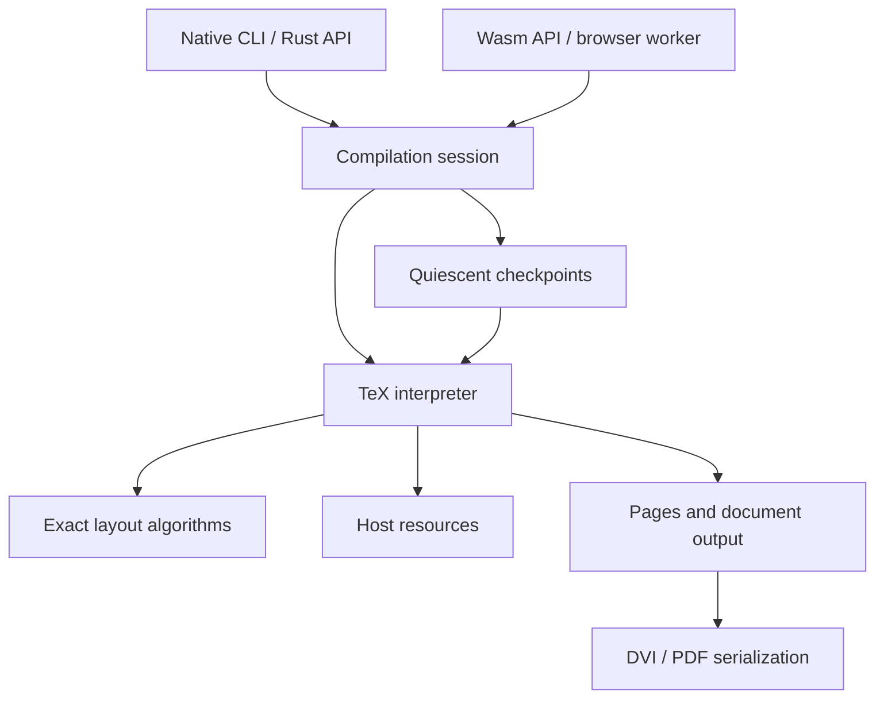

# Umber4: high-level architecture proposal

A working proposal for the execution model, object lifetimes, and checkpoint
strategy. Detailed data structures will follow from exploring these areas.

## 1. Goals and initial scope

Build one faithful TeX interpreter in Rust, runnable as a native library/CLI and
as a WebAssembly module. Native full compilation should perform comparably to
native pdfTeX. Persistent sessions should periodically retain resumable machine
checkpoints, then use them to avoid repeating unchanged work after source edits.
Checkpoint support must have a measured, bounded cost in both time and memory.

Proposed compatibility destination: TeX82, e-TeX, and the pdfTeX behavior needed
to execute real pdfLaTeX formats and packages and generate PDF. LaTeX is a program
executed by the interpreter, not a collection of recognized document commands.
pdfTeX includes e-TeX extensions and supports both DVI and PDF output, so a
pdfTeX compatibility claim needs a feature matrix beyond the TeX82 primitives.
See the [pdfTeX project description](https://www.tug.org/applications/pdftex/).

## 2. Central recommendation

Implement TeX through ordinary Rust control flow, using compact data structures
and arenas matched to the lifetimes of TeX objects. Take checkpoints at quiescent
boundaries where temporary execution state has already disappeared. Resume by
restoring the persistent document state and entering the same outer driver loop.

Choose the checkpoint boundary and the allocation lifetimes together. A boundary
outside a paragraph at group level zero can make scanner scratch, paragraph
working memory, and group-local work disappear before a snapshot is taken.
That considerably reduces both snapshot size and the amount of machinery needed
in the interpreter.

Use a different storage strategy for each kind of data. Interned names can live
for the process; paragraph scratch can be rewound after line breaking; definitions
can occupy immutable session storage; small semantic tables can simply be copied.
Checkpointing should fit those representations rather than impose a universal
persistent heap.

## 3. System boundaries

The interpreter executes TeX in document order. A compilation session keeps the
current document, its checkpoints, and completed output. Native and Wasm adapters
provide resources and expose the session to their callers. Layout and output are
modules with direct access to the data they need; crate boundaries can follow as
those interfaces become clear.

The portable implementation uses ordinary Rust containers and allocation.
Filesystem access and resource acquisition belong to the adapters. For the
browser target, `wasm32-unknown-unknown`, Rust's standard library provides
containers but lacks working filesystem and thread-spawn services.
See the [Rust target documentation](https://doc.rust-lang.org/stable/rustc/platform-support/wasm32-unknown-unknown.html).

## 4. Execution through Rust control flow

Scanning a number, matching macro arguments, expanding a command, constructing a
paragraph, and running an output routine should primarily be Rust functions with
local variables and ordinary calls. Their progress is encoded in the Rust stack.
The outer interpreter loop regains control when an operation finishes and decides
whether this is a checkpoint opportunity.

Keep persistent data where TeX itself needs it: current meanings, registers,
source positions, saved values for groups, and unfinished page material. Token
consumption also needs cursors for active files and replacement lists. Represent
those cursors compactly where the input algorithm needs them, while keeping the
scanner's branches, intermediate values, and return path in Rust control flow.
A token-source stack can serve the ordinary input loop without making every
expansion or scanner operation a resumable state machine.

The hot path should work with compact values and contiguous storage:

- Character tokens encode their character and category code. Control-sequence
  tokens carry an interned identity; their current meaning comes from a direct
  table lookup. A 32-bit token is a useful starting point for the classic profile.
- Definitions hold immutable token sequences. Expansion reads slices and argument
  ranges, with invocation scratch allocated in bulk and released when the
  invocation finishes.
- Equivalents, registers, and category codes use dense tables where their domains
  make that practical.
- Layout uses compact node representations and working arrays chosen for the
  access patterns of each algorithm.

TeX arithmetic uses integer algorithms with the required rounding and overflow
behavior. Expansion and layout loops should compile into straightforward release
code, with allocation and ownership bookkeeping paid at the relevant object or
arena boundary. Optional macro precompilation can be explored once the basic
execution path is working and measurable.

## 5. Object lifetimes and allocation

The allocation architecture should make an object's intended lifetime natural:
its owner chooses the storage at creation, and the end of that owner's work
provides the reclamation point. The following are the main expected lifetimes.

### Process lifetime: identities and reusable immutable data

Intern control-sequence names and other useful canonical token identities in a
process-owned append-only store. Common names are small and likely to recur
across documents and edits. Character tokens can usually be encoded directly;
individual token occurrences remain in their containing lists or input buffers.

Interned identities remain stable when execution rolls back. If an edit occurs
20% into a document, names discovered in the remaining 80% stay available and can
be reused during recompilation. A checkpoint captures document-specific meanings,
while the interner continues growing independently. An identity introduced after
a checkpoint starts with the default meaning when that checkpoint is restored.

Loaded font metrics, immutable font bytes, and reusable format data are also good
candidates for process-owned caches. The process pays for each useful immutable
resource once and subsequent compilations share it.

### Call and invocation lifetime: scanning and expansion scratch

Scalar scanner state lives in Rust locals. Argument matching and temporary token
construction use reusable buffers or a bump region belonging to the operation or
invocation. Argument storage follows the invocation consuming it: recursive calls
can use arena marks, while replacement-list cursors in the input loop can retain
argument ranges until their input is exhausted. Whole ranges are reclaimed
together, giving ordinary expansion cheap allocation.

When an operation creates a durable value, such as a macro replacement list, it
builds that value in the destination store or transfers the completed buffer to
it. The scratch region then rewinds as part of returning from the operation.

### Group lifetime: local bindings and restoration data

The save stack records the values restored when a group ends. Group-local
restoration records and temporary construction buffers can occupy a stack arena:
closing the group restores bindings and rewinds its storage in the same operation.

The values named by those bindings have their own lifetimes. A macro replacement
list lives in the definition store, so an invocation can keep reading it after
its binding is restored. A global assignment writes into the persistent semantic
tables and allocates its value in the appropriate session store. This makes local
binding lifetime and value lifetime separate, straightforward choices.

### Paragraph lifetime: layout working memory

Line-breaking candidates, active lists, measurement buffers, and related
algorithm scratch belong to a paragraph arena. The paragraph function performs
its work, places the resulting lines in page/list storage, then rewinds the
working arena before returning. Large buffers can retain capacity for the next
paragraph.

The resulting lines have a longer lifetime than the computation that found them.
Building them directly in their destination storage keeps this distinction
visible in the layout API.

### Session lifetime: definitions and persistent TeX values

Immutable macro bodies and token lists are well suited to a session-owned
segmented bump store. Redefinition changes a table entry; the old body stays
available to an active invocation and to any checkpoint using that definition.
Starting with session lifetime makes their ownership cheap and simple. Segment
reclamation or reuse of identical bodies across replay can be added where actual
session workloads justify it.

Boxes, marks, insertions, and unfinished page lists belong to stores organized
around their semantic owners. A box register owns its box until replacement or
transfer; page construction owns material until it is shipped or transferred;
marks can remain useful on later pages. Typed pools or object arenas can support
these transfers without an allocation for each node. Their snapshot behavior can
be chosen separately from the immutable definition store.

### Page and result lifetime: completed output

A shipped page becomes an owned, immutable output object with its required
resource references. Its output data can occupy a page arena retained by the
result and relevant checkpoints. The interpreter's page-building storage can then
be recycled as that work completes. Saved boxes and other independently owned
material continue in their own stores.

These lifetimes suggest a small set of allocation primitives: append-only stores,
rewindable scratch arenas, dense arrays, and pools for transferable objects.
A custom arena layout or bump allocator may use unsafe code in a narrow primitive.
Its documentation should explain why its allocation layout, references, and
reclamation are valid, so callers can use a simple API with clear lifetimes.

## 6. Quiescent checkpoints

Start by exploring a boundary at group level zero, outside a paragraph, after
control has returned to the outer interpreter loop and active scanning,
expansion, and output-routine calls have completed. File input positions and
unfinished page material may still persist; temporary computation has ended.
The exact boundary is a design choice to settle with representative TeX execution.

This boundary defines the checkpoint's contents. If group restoration is complete
and paragraph working memory has been released, those stores are empty by
construction. A checkpoint retains the document state that crosses the boundary,
with each component using a suitable representation:

| Kind of data                                     | Possible checkpoint representation                 |
| ------------------------------------------------ | -------------------------------------------------- |
| Process-owned identities and immutable resources | Shared directly; continue to exist across rollback |
| Small scalar state and dense tables              | Copied at the boundary                             |
| Immutable definitions and completed pages        | References into their existing stores              |
| Larger, sparsely modified tables                 | Chunked copies or a compact change log             |
| Mutable boxes and unfinished page material       | Pool snapshot or copies of the retained structures |
| Source positions and output progress             | Small records associated with the checkpoint       |

A modest table copy may be faster and simpler than copy-on-write checks on every
assignment. A large table with sparse changes may benefit from chunking. The
node store may favor copying the relatively small amount of material left between
paragraphs. Choose these independently, based on the work they save and the costs
they introduce during ordinary execution.

Checkpoint creation is a bulk operation at the boundary. Restoring one reestablishes
these persistent values, resets the associated scratch stores, and reenters the
outer loop. Checkpoints stay in memory for the compilation session.

## 7. Scheduling at checkpoint boundaries

The interpreter runs uninterrupted between checkpoint boundaries. At a boundary
it can retain a snapshot and yield to the host; resumption enters the outer loop
with the checkpoint state. Host-visible scheduling and cooperative cancellation
use these same boundaries.

Checkpoint cadence therefore follows document structure. A long paragraph or
long-running expansion can delay the next opportunity. Run browser compilation
in a worker, and use measurements to decide whether the chosen boundaries are
frequent enough. Boundary selection is the way to improve responsiveness while
keeping the execution model based on ordinary calls.

Native adapters can resolve resources synchronously. For asynchronous browser
acquisition, an unresolved resource can return an ordinary error/request through
the Rust calls. The session restores the preceding checkpoint and yields there;
once the resource arrives, execution repeats from that checkpoint. The request
records what the host needs to fetch, while the checkpoint supplies the restart
state.

## 8. Resources and output

A session owns input resources, generated-file buffers, and completed pages.
The native adapter serves files; the browser adapter serves cached bytes and
fetches missing resources. The interpreter reads these through a small resource
interface with ordinary byte access in the hot path.

Generated files can be represented as buffers with TeX's normal stream behavior.
A checkpoint retains the buffer versions or lengths needed to resume its output
position. The same idea applies to logs and diagnostics: they are appendable
session data with a saved position.

Page output is produced in document order. DVI and PDF backends consume owned page
data and retain their document-wide structures, such as font and PDF object
information. Their checkpoint representation belongs to each backend. Retaining
completed pages lets a resumed compilation reuse its output prefix and construct
the rest of the document. The final PDF can be serialized from this combined
output; its exact representation is an area for a later design.

Auxiliary files and repeated TeX passes fit above the interpreter in the session
or application layer. Their detailed orchestration can follow once a single pass
and its checkpoint behavior are working.

## 9. Memory use over a session

Bulk allocation makes memory behavior largely a question of store sizes and
lifetimes. Paragraph scratch is reused; process interners and resource caches
accumulate reusable data; definitions live with the session; output and snapshots
live as long as the application keeps them.

Checkpoint history is an application-level choice about memory versus repeated
work. Releasing an old checkpoint releases the storage retained only for that
snapshot. The application can retain more checkpoints around the part of a
document being edited and fewer elsewhere. We can choose a simple initial policy
and refine it from measurements.

Measure the cost of long edit sessions as well as individual compilations.
Process-lifetime identities are a deliberate investment in reuse. Larger values,
such as successive macro bodies or saved node versions, may benefit from shorter
storage generations if their retained size becomes significant. Those choices
can evolve independently of the interner and scratch allocators.

## 10. Performance and correctness during development

Use native pdfTeX as the performance reference on real documents, alongside
smaller workloads that isolate scanning, expansion, paragraph construction, and
page output. Compare full compilation and repeated edits, and measure native and
Wasm execution of the same interpreter.

The most useful early measurements are time spent executing versus checkpointing,
allocation frequency, bytes copied per checkpoint, and memory retained across
recompilations. Release-code inspection should show where the design introduces
extra work in the token and node loops. These observations can guide table layout,
arena sizes, and snapshot strategies without fixing them in advance.

Check behavior against TeX/pdfTeX and compare a resumed run with a fresh one.
Definitions, local/global assignments, saved boxes, and output routines are useful
examples because they exercise both semantics and lifetimes. Grow these checks
with the interpreter as it starts compiling ordinary documents.

## 11. Areas to develop next

First explore the interaction between ordinary execution and quiescence: where
the driver regains control, what is still live there, and how frequently those
points occur. Use that to develop the allocation layout and checkpoint strategy
for each major class of objects.

A small interpreter that handles input, definitions, groups, and simple output
can already exercise the central design. Paragraph and page construction then
bring in the larger working arenas and retained node stores. Those executable
examples will help choose the structures before broadening compatibility.

The next detailed designs should cover:

- The input and expansion loops, with temporary state in Rust control flow.
- Object stores and lifetime transitions for definitions, groups, paragraphs,
  boxes, and pages.
- The quiescence boundary and per-component snapshot representations.
- Resource access and backend output storage around that boundary.
