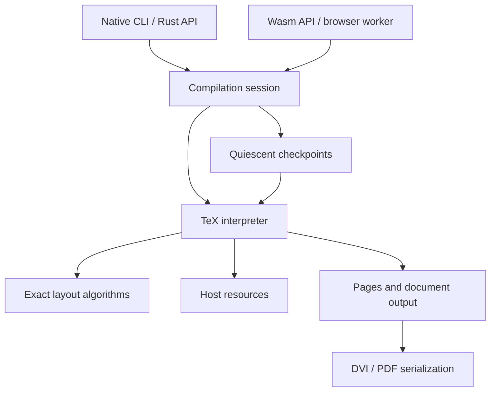

# Umber4: high-level architecture proposal

A working proposal for the execution model, object lifetimes, and checkpoint
strategy. The linked subsystem proposals develop the data structures and hot
paths; implementation and measurements will test these choices.

## 1. Goals and initial scope

Build one faithful TeX interpreter in Rust, runnable as a native library/CLI and
as a WebAssembly module. Native full compilation should perform comparably to
native pdfTeX. Persistent sessions should periodically retain resumable machine
checkpoints, then use them to avoid repeating unchanged work after source edits.
Checkpoint support must have a measured, bounded cost in both time and memory.

Proposed compatibility destination: TeX82, e-TeX, and the pdfTeX behavior needed
to execute real pdfLaTeX formats and packages and generate PDF. LaTeX is a program
executed by the interpreter, not a collection of recognized document commands.
pdfTeX includes e-TeX extensions and supports both DVI and PDF output, so a
pdfTeX compatibility claim needs a feature matrix beyond the TeX82 primitives.
See the [pdfTeX project description](https://www.tug.org/applications/pdftex/).

## 2. Central recommendation

Implement TeX through ordinary Rust control flow, using compact data structures
and arenas matched to the lifetimes of TeX objects. Take checkpoints at quiescent
boundaries where temporary execution state has already disappeared. Resume by
restoring the persistent document state and entering the same outer driver loop.

Checkpoint eligibility is a property of machine state: the outer driver is about
to read a command in external vertical mode, no construction or output routine is
unfinished, and operation scratch is empty. Ordinary assignment groups may remain
open; their save records are explicit state. Paragraph endings are the preferred
cadence, with additional opportunities after output routines and during preamble
execution. [checkpoints.md](checkpoints.md) defines the predicate and scheduling.

The system allocator supplies backing chunks and occasional capacity growth.
Ordinary interpretation creates and releases objects through reusable stores
selected by semantic lifetime. This applies to headers and descriptors as well as
tokens and nodes: no routine system allocation per invocation, definition, glyph,
or break candidate. [storage.md](storage.md) defines the storage contract.

Build data directly in its destination storage and reuse existing immutable
ranges. Transfers can move ownership without moving contents. Copy a small escaping
range when retaining its backing would keep disproportionate dead storage alive;
zero-copy is an optimization, not a semantic requirement.

## 3. System boundaries

The interpreter executes TeX in document order. A compilation session keeps the
current document, its checkpoints, and completed output. Native and Wasm adapters
provide resources and expose the session to their callers. Layout and output are
modules with direct access to the data they need; crate boundaries can follow as
those interfaces become clear.

The portable implementation uses the same lifetime-based stores on both targets.
Reusable Rust containers remain suitable for stacks, tables, and chunk directories.
Filesystem access and resource acquisition belong to the adapters. For the
browser target, `wasm32-unknown-unknown`, Rust's standard library provides
containers but lacks working filesystem and thread-spawn services.
See the [Rust target documentation](https://doc.rust-lang.org/stable/rustc/platform-support/wasm32-unknown-unknown.html).

## 4. Execution through Rust control flow

Scanning a number, matching macro arguments, expanding a command, constructing a
paragraph, and running an output routine should primarily be Rust functions with
local variables and ordinary calls. Their progress is encoded in the Rust stack.
The outer interpreter loop regains control when an operation finishes. It considers
checkpoint eligibility there, after consuming any already-read command.

Keep persistent data where TeX itself needs it: current meanings, registers,
source positions, saved values for groups, and unfinished page material. Token
consumption also needs cursors for active files and replacement lists. Represent
those cursors compactly where the input algorithm needs them, while keeping the
scanner's branches, intermediate values, and return path in Rust control flow.
A token-source stack can serve the ordinary input loop without making every
expansion or scanner operation a resumable state machine.

The hot path should work with compact values and contiguous storage:

- Character tokens encode their character and category code. Control-sequence
  tokens carry an interned identity; their current meaning comes from a direct
  table lookup. A 32-bit token is a useful starting point for the classic profile.
- Definitions hold immutable token sequences. Expansion reads slices and argument
  ranges, with invocation scratch allocated in bulk and released when the
  invocation finishes.
- Equivalents, registers, and category codes use dense tables where their domains
  make that practical.
- Layout uses compact node representations and working arrays chosen for the
  access patterns of each algorithm.

TeX arithmetic uses integer algorithms with the required rounding and overflow
behavior. Expansion and layout loops should compile into straightforward release
code, with allocation and ownership bookkeeping paid at the relevant object or
arena boundary. Optional macro precompilation can be explored once the basic
execution path is working and measurable.

See [expansion.md](expansion.md) for the input and expansion loop design.
Character scanning and primitive/group execution are developed in
[input.md](input.md) and [execution.md](execution.md).

## 5. Object lifetimes and allocation

The allocation architecture should make an object's intended lifetime natural:
its owner chooses the storage at creation, and the end of that owner's work
provides the reclamation point. Linear execution lets us allocate successive
definitions, working data, and output into bump regions as they are produced.
Objects with different lifetimes or mutation patterns can use different stores.
The following are the main expected lifetimes.

### Session lifetime: identities; cache lifetime: reusable immutable data

Intern control-sequence names and other useful canonical token identities in a
session-owned append-only store. Names remain stable across edits and restores
within that session. Session-created names release at session teardown; baseline
names live with the format cache. Character tokens are encoded directly; token
occurrences remain in their containing lists or input buffers.

Interned identities remain stable when execution rolls back. If an edit occurs
20% into a document, names discovered in the remaining 80% stay available and can
be reused during recompilation. A checkpoint captures document-specific meanings,
while the interner continues growing independently. An identity introduced after
a checkpoint starts with the default meaning when that checkpoint is restored.

Loaded font metrics, immutable font bytes, and reusable format data can use bounded
process caches. Cache lifetime is separate from session identity lifetime. A shared
in-memory format carries an immutable name-ID prefix adopted by its sessions, so
its token bodies can be shared without rewriting IDs. New names belong to each
session's extension. Loading a format file constructs that baseline and remaps its
file-local names once. Process-wide mutable interning is not required.

### Call and invocation lifetime: scanning and expansion scratch

Scalar scanner state lives in Rust locals. Argument matching and temporary token
construction use reusable buffers or a bump region belonging to the operation or
invocation. Argument storage follows the invocation consuming it: recursive calls
can use arena marks, while replacement-list cursors in the input loop can retain
argument ranges until their input is exhausted. Whole ranges are reclaimed
together, giving ordinary expansion cheap allocation.

When an operation creates a durable value, such as a macro replacement list, it
builds that value directly in its destination store. Existing token ranges can
be retained and reused; completed buffers can transfer ownership in place.
The scratch region then rewinds as part of returning from the operation.

### Group lifetime: local bindings and restoration data

The save stack records the values restored when a group ends. Live restoration
records use reusable stack storage. A checkpoint copies ordinary group records
and retains their saved owners in snapshot storage; closing the live group cannot
invalidate that copy. Temporary construction buffers use marked scratch.

The values named by those bindings have their own lifetimes. A macro replacement
list lives in the definition store, so an invocation can keep reading it after
its binding is restored. A global assignment writes into the persistent semantic
tables and allocates its value in the appropriate session store. This makes local
binding lifetime and value lifetime separate, straightforward choices.

### Paragraph lifetime: layout working memory

Line-breaking candidates, active lists, measurement buffers, and related
algorithm scratch belong to a paragraph arena. The paragraph function performs
its work, places the resulting lines in page/list storage, then rewinds the
working arena before returning. Large buffers can retain capacity for the next
paragraph.

The resulting lines have a longer lifetime than the computation that found them.
Building them directly in their destination storage keeps this distinction
visible in the layout API.

### Persistent TeX values: semantic ownership

Immutable macro bodies and token lists are built in stable bump-allocated chunks.
Bindings, saved values, active sources, captured ranges, and checkpoints retain
the values they need. Redefinition changes a table entry and releases its old
owner; an active invocation or retained checkpoint keeps the old body available.
After the last owner disappears, its metadata and reservations become reusable.
Non-atomic ownership counters live in pooled headers; token loops advance ordinary
pointers. Durable definitions and transient expansion data use separate allocation
classes over the same allocator implementation. Builders publish destination
storage directly. The MVP's remaining allocation work is described in
[mvp.md](mvp.md); [storage.md](storage.md) defines the intended final model.

Boxes, marks, insertions, and unfinished page lists belong to stores organized
around their semantic owners. A box register owns its box until replacement or
transfer; page construction owns material until it is shipped or transferred;
marks can remain useful on later pages. Much of this material can be bump-allocated
as execution proceeds. Mutable nodes and tables use chunk-level copy-on-write;
uncommon payloads use typed pooled records or larger dedicated blocks. Shared
ownership does not require an individually heap-allocated wrapper.

### Page and result lifetime: completed output

A shipped page becomes an owned, immutable output object with its required
resource references. Its output data can occupy a page arena retained by the
result and relevant checkpoints. The interpreter's page-building storage can then
be recycled as that work completes. Saved boxes and other independently owned
material continue in their own stores.

These lifetimes use a small set of allocation primitives: scratch arenas, pooled
headers and metadata blocks, immutable token storage, mutable COW chunks, and
append storage. Growing their backing capacity may call the system allocator.
A custom arena layout or bump allocator may use unsafe code in a narrow primitive.
Its documentation should explain why its allocation layout, references, and
reclamation are valid, so callers can use a simple API with clear lifetimes.
See [storage.md](storage.md) for allocation and mutable roots and
[formats.md](formats.md) for shared startup baselines.

## 6. Quiescent checkpoints

Take checkpoints at eligible outer-driver boundaries, preferably after paragraphs.
Layout work has finished. File input positions, ordinary group save records, and
unfinished page material persist as document state.

Replacement-list cursors and their argument storage can also remain as pending
input. Their checkpoint behavior is developed in [expansion.md](expansion.md).

This boundary defines the checkpoint's contents. Operation and paragraph scratch
are empty; ordinary group restoration records need not be. Persistent data uses
representations suited to its lifetime and mutability:

| Kind of data                               | Possible approach                                                 |
| ------------------------------------------ | ----------------------------------------------------------------- |
| Session identities and cached resources    | Keep available across rollback                                    |
| Immutable definitions and completed output | Retain their existing storage                                     |
| Small mutable values and tables            | Copy at the boundary                                              |
| Group and conditional stacks               | Copy records and retain saved owners                              |
| Larger mutable nodes and tables            | Share pooled chunks; copy on first mutation                       |

Each store can make its own choice. Bump allocation handles much of the linear
construction work, while snapshot sharing and mutation are handled where each
data type needs them. The detailed representations belong in the storage design.

Checkpoint creation is a bulk operation at the boundary. Restoring one reestablishes
these persistent values, resets the associated scratch stores, and reenters the
outer loop. Checkpoints stay in memory for the compilation session.
[checkpoints.md](checkpoints.md) develops retained roots, restore, and prefix
restart using this boundary.

## 7. Scheduling at checkpoint boundaries

Normal scheduling retains a checkpoint at an eligible boundary and yields to the
host. Cadence follows completed paragraphs and a coarse work budget for other
eligible boundaries. Run browser compilation in a worker.

Cancellation is independent of eligibility. Coarse checks in expansion and long
scans/layout loops can return an interruption through ordinary calls. The session
discards the incomplete attempt back to its last checkpoint; it cannot resume at
the interrupted instruction. A portable work limit also bounds attempts when the
host cannot expose an asynchronous cancellation flag.

Native adapters can resolve resources synchronously. For asynchronous browser
acquisition, an unresolved resource can return an ordinary error/request through
the Rust calls. The session restores the preceding checkpoint and yields there;
once the resource arrives, execution repeats from that checkpoint. The request
records what the host needs to fetch, while the checkpoint supplies the restart
state. Prepared resource bundles and prefetching previously used dependencies keep
this replay path exceptional during ordinary browser use.

## 8. Resources and output

A session owns input resources, generated-file buffers, and completed pages.
The native adapter serves files; the browser adapter serves cached bytes and
fetches missing resources. The interpreter reads these through a small resource
interface with ordinary byte access in the hot path.

Generated files can be represented as buffers with TeX's normal stream behavior.
File contents and individual stream positions/buffers are versioned document
state, including aliased handles and the main output file. Logs and diagnostics
are appendable session data with a saved position.

Ordered shipout produces owned page output and updates the DVI/PDF document-wide
structures, such as font and PDF object information. Their checkpoint
representation belongs to each backend. Retaining
completed pages lets a resumed compilation reuse its output prefix and construct
the rest of the document. Final PDF serialization continues the logical output
file, reusing completed content streams and finalizing document resources.
[resources.md](resources.md) and [output.md](output.md) develop I/O ordering,
backend state, and serialization.

Auxiliary files and repeated TeX passes fit above the interpreter in the session
or application layer. Their detailed orchestration can follow once a single pass
and its checkpoint behavior are working.

## 9. Memory use over a session

Bulk allocation makes memory behavior largely a question of store sizes and
lifetimes. Paragraph scratch is reused; session interners and bounded resource caches
accumulate reusable data; definitions live through their semantic owners; output
and snapshots live as long as the application keeps them.

Checkpoint history is an application-level choice about memory versus repeated
work. Releasing an old checkpoint releases the storage retained only for that
snapshot. The application can retain more checkpoints around the part of a
document being edited and fewer elsewhere. We can choose a simple initial policy
and refine it from measurements.

Separate transient expansion allocations from durable definitions so a small
survivor does not routinely retain a chunk of dead invocation data. Checkpoint
metadata and output descriptors share append blocks as well as byte payloads;
retaining a growing output prefix must not repeatedly copy its complete history.
Bound empty-block caches and release session identities at session teardown.

## 10. Performance and correctness during development

Use native pdfTeX as the performance reference on real documents, alongside
smaller workloads that isolate scanning, expansion, paragraph construction, and
page output. Compare full compilation and repeated edits, and measure native and
Wasm execution of the same interpreter.

The most useful early measurements are time spent executing versus checkpointing,
allocation frequency, bytes copied per checkpoint, and memory retained across
recompilations. Release-code inspection should show where the design introduces
extra work in the token and node loops. These observations can guide table layout,
arena sizes, and snapshot strategies without fixing them in advance.

Check behavior against TeX/pdfTeX and compare a resumed run with a fresh one.
Definitions, local/global assignments, saved boxes, and output routines are useful
examples because they exercise both semantics and lifetimes. Grow these checks
with the interpreter as it starts compiling ordinary documents.

## 11. Detailed subsystem proposals

The deep dives share ordinary Rust execution, in-place construction, semantic
lifetimes, and the quiescent outer-driver checkpoint predicate. Layout and
checkpointing remain proposals; the expansion/register slice is implemented.

| Area                                                | Design                                   |
| --------------------------------------------------- | ---------------------------------------- |
| Character input and scanners                        | [input.md](input.md)                     |
| Token reading, expansion, and argument capture      | [expansion.md](expansion.md)             |
| Meanings, assignments, groups, and modes            | [execution.md](execution.md)             |
| Allocation, immutable spans, and mutable stores     | [storage.md](storage.md)                 |
| Fonts, character construction, and line breaking    | [paragraphs.md](paragraphs.md)           |
| Math lists and alignment templates                  | [math-alignments.md](math-alignments.md) |
| Page breaks, insertions, marks, and output routines | [pages.md](pages.md)                     |
| In-memory snapshots and prefix restart              | [checkpoints.md](checkpoints.md)         |
| Native/Wasm resources, streams, and replay          | [resources.md](resources.md)             |
| Ordered shipout and DVI/PDF serialization           | [output.md](output.md)                   |
| Bootstrap, Umber format export/read, and startup    | [formats.md](formats.md)                 |
| Native/Wasm execution and performance methodology   | [performance.md](performance.md)         |

The [expansion/register MVP](mvp.md) exercises the central representations and
provides [native measurements](mvp-results.md). The next architectural slice should
connect paragraph/page construction to snapshot, mutation, and restore, including
pending macro input and saved bindings. That exercises the storage model before
broader format and backend compatibility.
