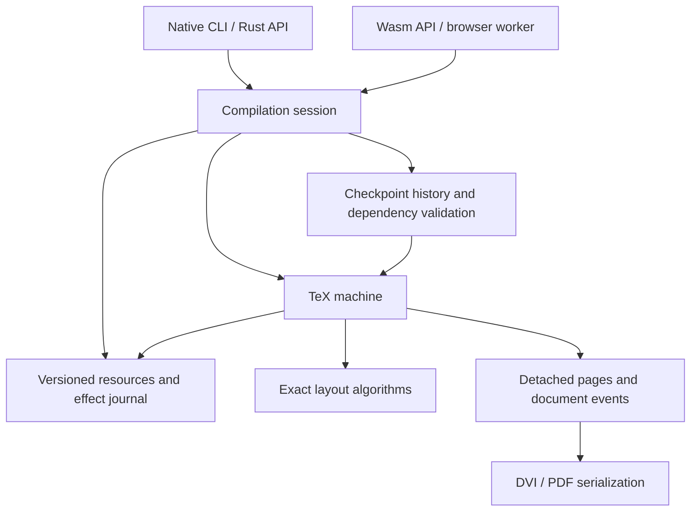

# Umber4: high-level architecture proposal

Status: draft for discussion. This document proposes the system's shape and
the contracts that must survive later optimization. No implementation or
performance result is implied. Detailed representations should be chosen through
focused design reviews and executable experiments after this proposal is agreed.

## 1. Goals and initial scope

Build one faithful TeX interpreter in Rust, runnable as a native library/CLI and
as a WebAssembly module. Native full compilation should perform comparably to
native pdfTeX. Persistent sessions should periodically retain resumable machine
checkpoints, then use them to avoid repeating unchanged work after source edits.
Checkpoint support must have a measured, bounded cost in both time and memory.

Proposed compatibility destination: TeX82, e-TeX, and the pdfTeX behavior needed
to execute real pdfLaTeX formats and packages and generate PDF. LaTeX is a program
executed by the interpreter, not a collection of recognized document commands.
pdfTeX includes e-TeX extensions and supports both DVI and PDF output, so a
pdfTeX compatibility claim needs a feature matrix beyond the TeX82 primitives.
See the [pdfTeX project description](https://www.tug.org/applications/pdftex/).

Use pinned upstream sources, manuals, and reference executables as authorities.
Distinguish implemented, unsupported, and intentionally host-restricted behavior.
The first execution slice may be small, but its semantics must be real TeX.
Preserve integer arithmetic, category-code behavior, expansion order, grouping,
layout decisions, and documented error recovery. Output equivalence includes
generated auxiliary files and diagnostics, not just similar-looking pages.

The initial design does not inherit all of Umber3's product scope. Modern Unicode
shaping, HTML output, bibliography engines, and a full distribution downloader
are possible later extensions. They are not prerequisites for proving the
interpreter, PDF compatibility, and incremental compilation. Native and browser
hosts need a usable resource interface from the start.

## 2. Central recommendation

Build a sequential, explicitly represented TeX machine with compact hot data,
memory regions chosen by semantic lifetime, and snapshots that retain immutable
storage and share mutable state at coarse granularity. Incremental compilation
restores this same machine; it never substitutes a second evaluator.

TeX execution order is authoritative. Parallelism belongs initially in host
resource acquisition or processing detached output, where ordering permits it.
Native performance should not depend on browser threads or a different native
execution engine.

Three separations carry most of the architecture:

- _Semantic lifetime versus allocation mechanism:_ groups, invocations,
  paragraphs, pages, jobs, and checkpoint history have different escape rules.
- _Live execution versus retained state:_ execution owns mutable chunks; retained
  checkpoints and completed results hold stable roots into immutable versions.
- _Interpreter effects versus publication:_ file writes, diagnostics, and output
  remain revision-local until the host accepts a result.

## 3. System boundaries

The session owns revisions, resources, history budgets, candidate execution, and
acceptance. The machine owns TeX semantics: tokenization, expansion, assignments,
groups, modes, layout construction, output routines, and primitive execution.
Layout algorithms operate on well-defined data and exact arithmetic; they do not
perform host I/O. Output serialization consumes owned pages and document events,
not references into live interpreter arenas.

Start with a small module structure. Likely eventual package boundaries are the
portable engine, native adapter, and Wasm adapter; detach arithmetic or output
only when their interfaces are clear. Avoid building a family of generic memory
and lifecycle crates before a working interpreter exercises their contracts.

The portable core may use Rust's standard library for containers, but cannot
require filesystem, network, clock, process, or thread services. The browser
target is initially `wasm32-unknown-unknown`; its standard library does not
provide working filesystem or thread-spawn services. Resource and environmental
inputs therefore cross an explicit host boundary.
See the [Rust target documentation](https://doc.rust-lang.org/stable/rustc/platform-support/wasm32-unknown-unknown.html).

## 4. The interpreter and its hot representations

Model execution with explicit input/expansion frames, conditional and save
stacks, scanner state, current modes, semantic tables, lists, and page-builder
state. Rust functions may implement bounded operations, but a suspended engine
must not depend on a live Rust call stack. Recursive macro expansion belongs on
engine-owned stacks.

Proposed hot representations:

- Compact tagged tokens, aiming for a 32-bit word for the classic compatibility
  profile. Character tokens retain their category code at tokenization; control
  sequence tokens carry stable symbol IDs and resolve their current meaning when
  executed. Provenance lives in side storage.
- Dense indexed tables for common equivalents, registers, and category codes;
  intern names once rather than hashing strings at every invocation. Avoid a
  separate registry that mirrors an already authoritative table.
- Immutable token slices for macro bodies and parameter texts, with input frames
  referring to ranges. Expansion splices argument ranges rather than repeatedly
  copying replacement lists. Active invocations retain their original definition
  after that control sequence is redefined.
- Compact typed node pools and contiguous working arrays for layout. Choose
  array-of-structures or structure-of-arrays by access pattern; do not force every
  node kind into a large general-purpose object.
- Tagged command dispatch and direct indexed access in hot loops. Host callbacks,
  reference counting, heap allocation, and dynamic dispatch should occur at
  resource, chunk, or publication boundaries rather than per token.

Macro precompilation is an optional measured optimization. It must preserve
late-bound meanings, exact argument matching, scanner restrictions, and token
consumption on errors. Start from immutable token lists; do not let a macro VM
become a prerequisite for the first faithful executor.

Use exact TeX numerical algorithms with explicit overflow and rounding behavior.
Machine word size, allocator addresses, hash iteration order, and floating-point
rounding must not change native/Wasm semantics. Handles are indices or
region-relative offsets, never serialized pointers. Compact IDs need checked
capacity limits and a defined exhaustion outcome.

## 5. Memory follows semantic reachability

Use several specialized stores rather than one universal allocator. Regions may
obtain chunks from the ordinary allocator; most individual semantic objects
should then be created and reclaimed without individual allocator calls.

| Semantic lifetime               | Proposed storage                              | Reclamation condition                                                 |
| ------------------------------- | --------------------------------------------- | --------------------------------------------------------------------- |
| Resource / reusable format      | Immutable validated chunks                    | No session, checkpoint, or result retains them                        |
| Scanner or layout operation     | Reusable bump scratch and working vectors     | Operation finishes and no resumable frame refers to the data          |
| Macro invocation / active input | Stack regions with explicit frame ownership   | Last frame consuming an argument or input range retires               |
| Definition / token list         | Immutable append segments, retained by owners | No meaning, save entry, invocation, or checkpoint reaches the segment |
| Mutable semantic tables         | Chunked dense arrays with versioned roots     | Old version loses its final checkpoint or candidate owner             |
| Mutable lists / saved boxes     | Typed recyclable pools with versioned chunks  | No live machine or retained snapshot reaches that allocation          |
| Completed output                | Immutable page regions and document resources | Last accepted/candidate/history/backend owner releases them           |

Scope exit is not enough to reclaim arbitrary TeX objects. A global definition
can survive its creating group. A saved definition must remain available for
restoration, an active macro can retain an old definition, and boxes, marks,
insertions, and output routines can carry nodes across paragraph or page
boundaries. A group arena is appropriate only for data proved not to escape, or
with a defined promotion rule applied before escape.

Likewise, a paragraph arena is excellent for line-breaking scratch. It cannot
be reset while the page builder retains its nodes. Detached output should copy
or transfer exactly the information required for rendering and PDF semantics;
then reclaim interpreter nodes only when no remaining semantic owner needs them.

Proposed ownership rules:

1. Durable stores never retain borrowed references into rewound scratch.
2. Cross-region references use typed IDs and explicit owning roots. Coarse chunk
   owners retain storage; individual tokens and nodes do not each carry an `Rc`.
3. Slot reuse is version-scoped. A checkpoint retains its own pool directory,
   allocator/free-list state, and generations where necessary. A later branch
   cannot mutate storage visible to an earlier snapshot or revive stale handles.
4. Immutable segments may retain some dead objects. Segment size and compaction
   policy must bound amplification; compaction/remapping happens at explicit
   boundaries, never as hidden per-token tracing.
5. Reclamation covers destructors, nested allocations, and retained capacity.
   Region rewind alone is sufficient only for representations whose contents
   have no additional owned resources, or whose destructors are handled explicitly.

Keep unsafe code narrow, with proofs for initialization, aliasing, bounds, and
reclamation. Safe indexed storage is the initial baseline. Do not export a Rust
reference across an allocation, copy-on-write mutation, checkpoint, or host call.

## 6. Checkpoints without cloning the whole heap

A checkpoint is a full resumable state, not a token cursor or a format dump.
It includes scalar execution state and roots for:

- Source/input cursors, buffered lines, token sources, expansion and scanner
  continuations, conditionals, and parameter storage.
- Symbols, equivalents, category codes, registers, groups/save stack, fonts,
  hyphenation state, and profile-specific state including random generators.
- All unfinished horizontal/vertical/math lists, paragraph work when applicable,
  page-builder state, insertions, marks, and output-routine continuation.
- Resource observations and environmental inputs; open input/output streams,
  generated-file versions, delayed writes, diagnostics/log events, pages, and
  document-level PDF state.
- Allocation roots and any free-list or identity state required to interpret
  stored handles consistently.

Proposed snapshot mechanism: immutable macro/resource/output segments are shared;
mutable tables and pools use chunk-level copy-on-write; short scalar state and
small stacks are copied. Growing stacks may use segmented tails, but their
complexity must earn its place through measurement. Checkpoint creation freezes
roots and leaves execution ready to obtain private writable chunks.

Use an explicit uniqueness/epoch check to acquire a mutable chunk, then batch
operations while the borrow is valid. Do not introduce an ownership check for
every scalar store by default. No checkpoint is created while such a borrow is
active. A chunk is copied at most once per sharing interval before subsequent
mutations use that private version.

This is a hypothesis, not a free performance win. Copy amplification depends on
chunk size and mutation density; root directories and active stacks also cost
time and memory to snapshot. A large sparsely changed table favors smaller
chunks, while a sequentially edited list may favor another layout. Benchmark
representative traces before choosing chunk sizes or a persistent directory.

Measure chunked copy-on-write against a deep-copy checkpoint baseline and a
coarse mutation-journal alternative. Journaling may suit sparse table changes,
but universal undo logging would add work to every node mutation and complicate
branching. The design should support different storage policies where semantic
access patterns warrant them.

## 7. Scheduling and resuming checkpoints

Expose a driver operation conceptually like
`advance(work_budget) -> Progress | ResourceRequest | Complete | DiagnosticStop`.
At return, all resumable state is owned by the machine. Cancellation and budget
checks occur at defined execution transitions and inside potentially long
scanning/layout loops. Tight loops should process batches rather than call the
host after each token.

Distinguish a _scheduler yield_ from a _retained history checkpoint_. Yields may
be frequent for browser responsiveness; snapshot history is created only when
its expected replay benefit justifies retention cost. A parser can yield without
making that moment useful as an edit restart point.

Prefer checkpoints at top-level command, completed paragraph, or settled page
transitions, subject to an explicit eligibility predicate. Do not assume `\par`,
group exit, or shipout empties the engine: pending expansion, output routines,
insertions, and partially built pages can all remain. Their state must either be
represented in the snapshot or make that boundary ineligible.

Set an interval in measured execution work, with a host policy for wall-time
responsiveness. If preferred boundaries are too far apart, either use an owned
continuation that permits a mid-operation snapshot or accept and report the
replay gap. A long macro expansion or paragraph must not turn a claimed fixed
checkpoint interval into an unbounded promise. Continuation granularity is an
early design question, especially for paragraph breaking and input scanners.

Resource acquisition happens outside the interpreter. Prefer requesting missing
bytes from an owned continuation before semantic mutation. If a particular
operation cannot yet suspend safely, return to a previously retained full state
and replay after acquisition; its staged effects must be discarded. Normal
control flow handles these outcomes, not panic unwinding or serialized Rust
stacks.

In-memory checkpoint sharing is the initial requirement. A portable on-disk
checkpoint schema is a separate facility with versioning and validation; it
cannot dump Rust layouts or native pointers. Reusable INITEX-style formats
similarly contain validated semantic state and start fresh job-local execution.

## 8. Incremental compilation is validated replay

Each candidate revision sees immutable, versioned source and resource data plus
its own generated-file overlay. Retain the last accepted result while the
candidate runs. The first incremental implementation reuses a valid execution
prefix and then runs the ordinary engine to completion.

For an edit, select the latest preceding checkpoint whose observations remain
valid under the candidate inputs. Track what execution actually observed, not
just the current source position: include nested inputs, file search results,
existence probes, EOF, metadata, and all bytes already buffered or scanned ahead.
Changing the end of a buffered line can invalidate a checkpoint before its
apparent character cursor.

An open source cursor needs a stable mapping into the new source version and
proof that its buffered state and observed prefix remain identical. Begin with
conservative invalidation, even whole-file invalidation where necessary. Later,
immutable source pieces and range dependencies can retain more checkpoints
across edits without weakening the proof. A changed resource search order can
invalidate an unchanged file's resolution or a previous absence observation.

On restore, share the checkpoint's valid page/event prefix, replace the remaining
source view according to the validated mapping, fork its generated-file overlay,
and re-execute the remaining work. Group locality and unchanged visible text do
not prove validity: earlier macros, auxiliary reads, and output routines can
change later behavior.

Treat unchanged-suffix reuse as a later optimization. Matching rendered pages or
a short state hash is insufficient. It needs equivalent complete semantic state,
continuation, future resource/input observations, and file/output state, allowing
for revision-local IDs and relocated source spans. Hashes may reject candidates
quickly; acceptance requires structural equality or another documented proof.
Correct prefix replay remains useful without this optimization.

Incremental and full execution must agree under the same environment. Test edits
affecting definitions, category codes, grouping, includes, auxiliary files,
output routines, and EOF; include cancellation and edits while a candidate runs.
Source mappings belong to revisions. Preserve optional compact source origins
without enlarging every hot token; richer expansion ancestry can be developed
later and its production overhead must be measured.

## 9. Effects, output, and project passes

Every observable effect passes through revision-owned state: generated files,
terminal/log messages, diagnostics, pages, and document-level output records.
Checkpoints retain a coherent effect prefix. Restoring one discards candidate
effects after that prefix instead of repeating irreversible writes.

Model TeX's open/write/close streams and immediate versus delayed writes. The
candidate must read its own generated bytes when TeX semantics permit it.
Resource contents, lookup outcomes, job time, random state, and other
environmental inputs need stable replay behavior. Truly external effects such
as process execution require a separate host contract or an explicit restriction
on incremental replay; they cannot be repeated blindly.

At shipout, create owned page data and document events while respecting output
routine execution. DVI is useful as an early positioning oracle; PDF remains the
initial product output target. PDF has shared font subsets, object identities,
images, forms, links, and cross-references, so detachable pages alone do not
constitute a complete backend snapshot. Retain semantic PDF state with the
machine or journal and serialize it deterministically from coherent roots.

Initially regenerate the final PDF from retained and newly produced pages/events;
avoid promising byte-range patching of an existing PDF. Preview consumers can
reuse immutable page objects. Byte-for-byte reference PDF equivalence is a
separate question from layout and primitive compatibility; metadata, compression,
and object numbering require an explicit comparison policy.

Auxiliary files often require multiple TeX passes. The host/session layer can
orchestrate passes with a convergence limit and versioned generated-file inputs.
A checkpoint valid for one pass is not automatically valid after its input
auxiliaries change. Accept the final source revision, generated files,
diagnostics, and document artifacts together after a successful candidate.

## 10. Budgets and history policy

Bound execution work, input/expansion depth, reserved memory, retained checkpoints,
output, and resource retries. Report resource-limit outcomes distinctly from TeX
diagnostics. Allocation and snapshot failure must preserve the accepted revision;
staged growth must not partially publish broken roots.

Memory accounting includes physical chunks, directories, nested allocations,
scratch capacity, immutable resources, page data, and overlap during copying.
Report shared physical bytes separately from logical per-revision reachability.
Keep headroom for the accepted result plus a candidate and its copied chunks;
checkpoint eviction cannot release storage still owned by either one.

Prefer denser recent checkpoints and sparser older ones, subject to both a byte
budget and measured replay gaps. A format/job-start state supplies a cold
fallback. Eviction drops owners without per-object hot-loop tracing. Session
reset or explicit compaction may be necessary to bound interned names and dead
segments across a long edit history; a job arena that only grows is not enough.

## 11. Performance and correctness evidence

Agree on a benchmark corpus and reference configuration before claiming
comparability. Pin pdfTeX, formats, fonts, resources, command-line behavior, and
environmental inputs. Compare equal work, including equivalent output generation
and pass counts. Separate engine timing from process startup, resource fetching,
format preparation, and host publication, then also report end-to-end timing.

Proposed acceptance targets for discussion:

- Native full compilation with periodic checkpointing: corpus geometric-mean
  elapsed-time ratio at most 1.25 versus native pdfTeX, with each representative
  workload at most 1.5. Report individual results to expose poor cases.
- Checkpoint-enabled full execution: at most 10% additional elapsed time versus
  the same Umber4 engine without retained history under an agreed interval and
  history budget. Report snapshot time, bytes copied, and peak reserved memory.
- Incremental edits: report p50/p95 latency, replayed work, reuse distance, and
  peak memory for a fixed edit corpus. Include early edits and edits that invalidate
  most checkpoints; do not report only late-document best cases.
- Wasm: execute the same correctness and edit corpus in actual browser workers
  and report separately against native pdfTeX and native Umber4. The browser
  runtime's overhead is an additional measured gap, not assumed parity.

These numbers are proposed goals, not measurements. Browser memory budgets and
checkpoint cadence still need agreement. Tune based on macro-heavy documents,
plain text, mathematics, alignments, floats/output routines, and PDF assets;
microbenchmarks should explain production results rather than replace them.

Start correctness evidence with independent scanner/arithmetic fixtures,
reference-engine comparisons, and TeX's established validation tests where
applicable. Extend it to real plain TeX/LaTeX documents and packages. Compare
node/layout decisions, DVI/PDF structure, diagnostics, and auxiliary bytes under
an explicit normalization policy. Native and Wasm must agree, and every supported
incremental scenario must match a fresh run. Repeated restoration, branching,
history eviction, and dropped candidate states need memory-lifetime verification.

## 12. Design sequence and unresolved choices

The first deep review should cover the machine state and its ownership graph
together. Inventory resumable continuations, roots, escape paths, and mutations;
otherwise an allocator design will optimize lifetimes that TeX does not have.
Then develop storage/checkpoint representations, resource/effect semantics,
scanner/expander execution, layout, and output with concrete examples and measured
experiments.

Implementation should grow through executable vertical slices. A small real
interpreter handling input, definitions, groups, and writes should already
demonstrate checkpoint/restore parity. Extend it into exact paragraph/page
layout and detached output, then broad e-TeX/pdfTeX and package compatibility.
Do not postpone the first checkpoint experiment until after a complete engine,
or build a large memory framework without an interpreter to measure.

Decisions to settle during review:

| Question                            | Current recommendation                                                                          |
| ----------------------------------- | ----------------------------------------------------------------------------------------------- |
| Compatibility boundary              | Target pdfLaTeX through TeX82/e-TeX/pdfTeX; explicitly inventory missing features               |
| Snapshot representation             | Hybrid immutable segments and chunk-level copy-on-write; measure alternatives                   |
| Continuation granularity            | Explicit engine frames; establish safe bounded yield and snapshot points early                  |
| Arena escape handling               | Allocate persistent semantic objects durably; reserve scope arenas for proved scratch lifetimes |
| Incremental dependency granularity  | Conservative validation first, then source ranges and stable piece mappings                     |
| Suffix reuse                        | Defer until prefix replay is correct and its limitations are measured                           |
| Performance thresholds              | Review the proposed ratios, corpus, browser expectations, and history budget                    |
| Persistence across process restarts | Later portable schema; initial checkpoints remain in memory                                     |

The highest-risk hypothesis is that retained snapshots can preserve locality and
cheap mutation while bounding history memory. Resolve it with real interpreter
traces that exercise redefinition, saved boxes, and output routines before
committing to a universal pool representation.
